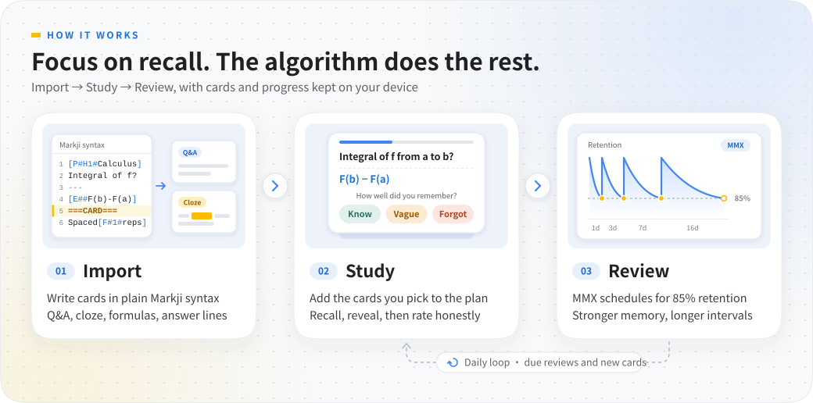
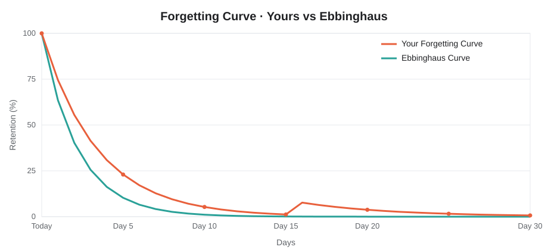
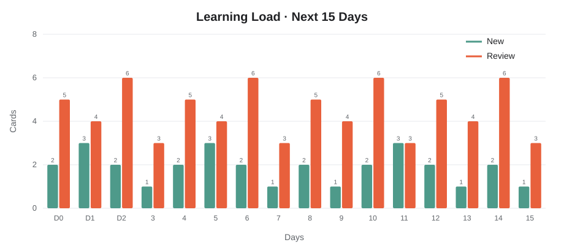
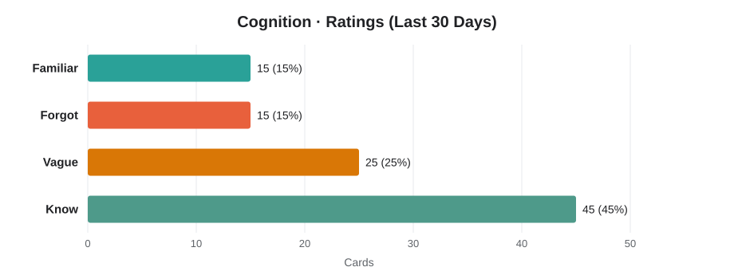

<p align="center">
  
</p>

<p align="center">
  <a href="README.md">简体中文</a> | <a href="README.en.md">English</a>
</p>

<p align="center">
  
  
  
</p>

**Offline-first open-source flashcard app**. Write cards in text to organize knowledge, add them to your study plan, then complete daily reviews and new learning with MMX scheduling.



## Why OpenMarkji

Memory requires spaced repetition, but manual scheduling is too tedious. OpenMarkji turns knowledge into cards and automatically calculates optimal review times. You focus on recall; the algorithm handles the rest.

## Core Features

**Text-based card creation**: Q&A, cloze deletion, and LaTeX formulas, with an answer line separating the question from its answer. Add headings, styles, and formulas using card syntax:

```text
[P#H1#Calculus · Fundamentals]
If F is an antiderivative of f, how is the definite integral computed?
---
[E##\int_a^b f(x)\,dx=F(b)-F(a)]
===CARD===
[P#H1#Grouped cloze]
Memory works through [F#1#right timing] and [F#2#active recall].
```

**Three-view statistics**: Forgetting curve, learning status, memory durability. See your memory retention over time, compared to the Ebbinghaus curve.







**Focused practice**: Randomly draw 10/20/50 cards from all, favorites, or difficult cards. Independent progress saving without disrupting daily plans.

**Complete data**: Drift+SQLite local storage, ZIP backup/restore support, media files included in backups.

## Quick Start

### Android Installation

[v1.06 Release](https://github.com/coffe01-10/openmarkji/releases/tag/v1.06). Most phones choose ARM64 APK; older devices can select the corresponding architecture on the release page. You can also download updates directly from Settings → About → Check for updates.

1. Create a new deck, import text or write cards
2. Select cards in the deck, click "Add to Plan"
3. Return to Today to start learning: recall first, then reveal, rate by actual feeling
4. Backup data in Settings; restore replaces current data and keeps a pre-restore backup

### Build from Source

```sh
flutter pub get
flutter build apk --release --split-per-abi
```

Or use the provided script (Windows Chinese path):

```powershell
./tool/build_android.ps1
```

### Web Preview

```sh
flutter build web --no-pub --no-web-resources-cdn
node tool/preview.mjs
# http://127.0.0.1:5127        Wide screen
# http://127.0.0.1:5127/phone  Phone container
```

## Algorithm Notes

`lib/algorithms/` retains MMX-5 / MMX-6 implementation with 85% target retention. Rating codes: Know 1, Vague 2, Forgot 3, Familiar 4.

Scheduling intervals use actual time differences between formal reviews; same-day relearning does not retrain long-term state. Editor, import, and study pages share the same parser and renderer.

## Project Structure

- `lib/data/`: Database, study sessions, backup, platform connections
- `lib/content/`: Card syntax parsing and text splitting
- `lib/domain/`: Decks, cards, queues, and preferences
- `lib/ui/`: Theme, Dock, pages, and content renderer
- `lib/algorithms/`: MMX core algorithms
- `test/`: Algorithm, import, transaction, UI regression tests

## License

[GPL-3.0 license text](third_party/GPL-3.0/LICENSE) · [Copyright and modification notices](third_party/GPL-3.0/NOTICE.md)
