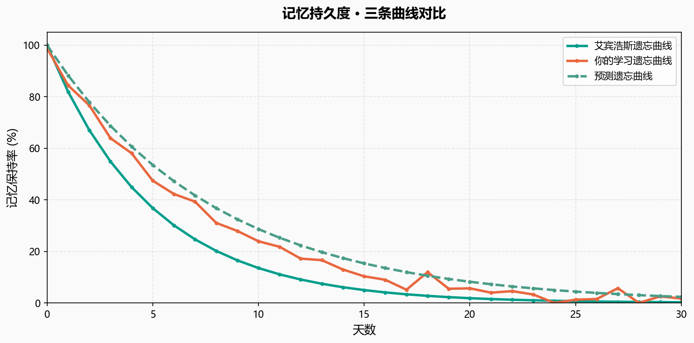
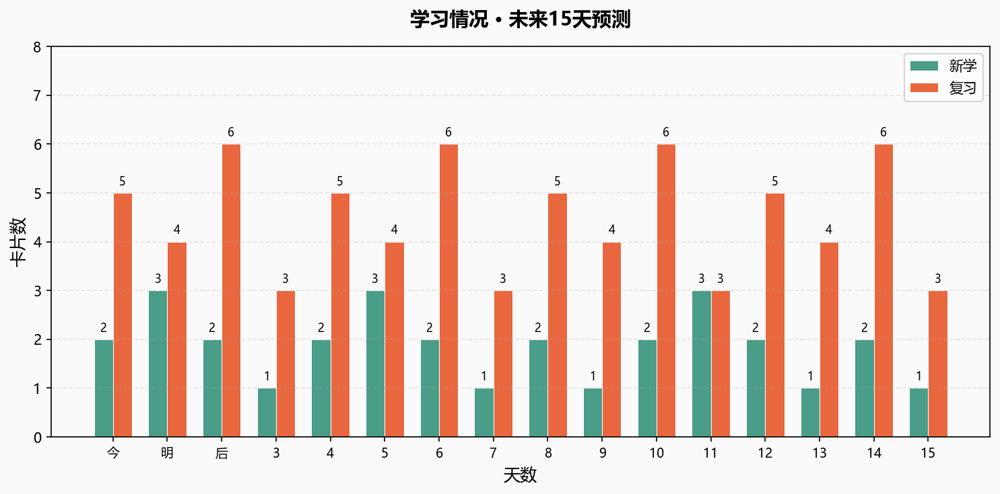
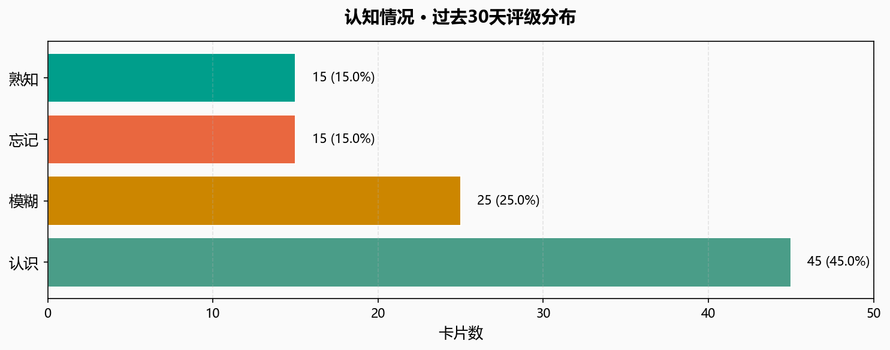
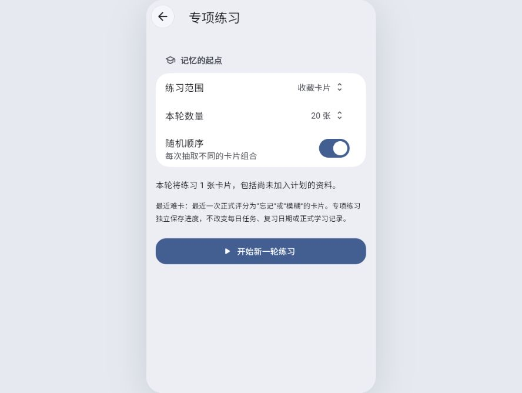

<p align="center">
  
</p>

<p align="center">
  <a href="README.md">简体中文</a> | <a href="README.en.md">English</a>
</p>

<p align="center">
  
  
  
</p>

**Offline-first open-source flashcard app**. Organize knowledge with Markji syntax, select cards to join the plan, then complete daily reviews and new learning with MMX scheduling.


## Why OpenMarkji

Memory requires spaced repetition, but manual scheduling is too tedious. OpenMarkji turns knowledge into cards and automatically calculates optimal review times. You focus on recall; the algorithm handles the rest.


## Core Features

**Four card types**: Q&A, cloze deletion, LaTeX formulas, answer lines. Write cards in plain text; automatic Markji syntax parsing.


**Three-view statistics**: Forgetting curve, learning status, memory durability. See your memory retention over time, compared to the Ebbinghaus curve.







**Focused practice**: Randomly draw 10/20/50 cards from all, favorites, or difficult cards. Independent progress saving without disrupting daily plans.



**Complete data**: Drift+SQLite local storage, ZIP backup/restore support, media files included in backups.

## Quick Start

### Android Installation

[v1.01 Release](https://github.com/coffe01-10/openmarkji/releases/tag/v1.01). Most phones choose ARM64 APK; older devices can select the corresponding architecture on the release page.

1. Create a new deck, import text or write cards
2. Select cards in the deck, click "Add to Plan"
3. Return to Today to start learning: recall first, then reveal, rate by actual feeling
4. Backup data in Settings; restore replaces current data and keeps a pre-restore backup

### Build from Source

```sh
flutter pub get
flutter build apk --release --split-per-abi
```

Or use the provided script (Windows Chinese path):

```powershell
./tool/build_android.ps1
```

### Web Preview

```sh
flutter build web --no-pub --no-web-resources-cdn
node tool/preview.mjs
# http://127.0.0.1:5127        Wide screen
# http://127.0.0.1:5127/phone  Phone container
```

## Algorithm Notes

`lib/algorithms/` retains MMX-5 / MMX-6 implementation with 85% target retention. Rating codes: Know 1, Vague 2, Forgot 3, Familiar 4.

Scheduling intervals use actual time differences between formal reviews; same-day relearning does not retrain long-term state. Editor, import, and study pages share the same parser and renderer.

## Project Structure

- `lib/data/`: Database, study sessions, backup, platform connections
- `lib/content/`: Markji syntax parsing and card cutting
- `lib/domain/`: Decks, cards, queues, and preferences
- `lib/ui/`: Theme, Dock, pages, and content renderer
- `lib/algorithms/`: MMX core algorithms
- `test/`: Algorithm, import, transaction, UI regression tests

## License

[MIT](LICENSE) · Preserves original licenses and modification notices for FlClash components.
