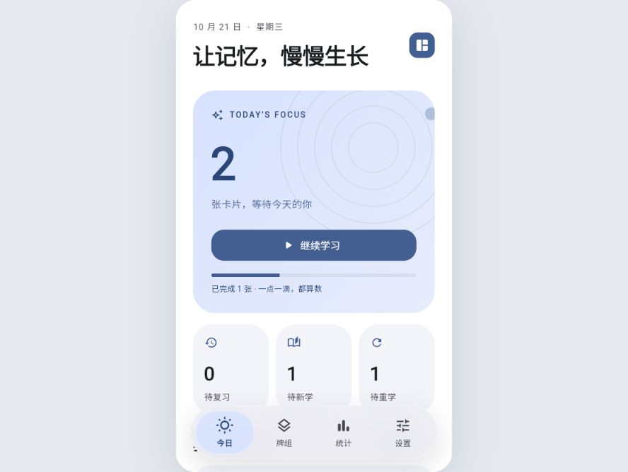
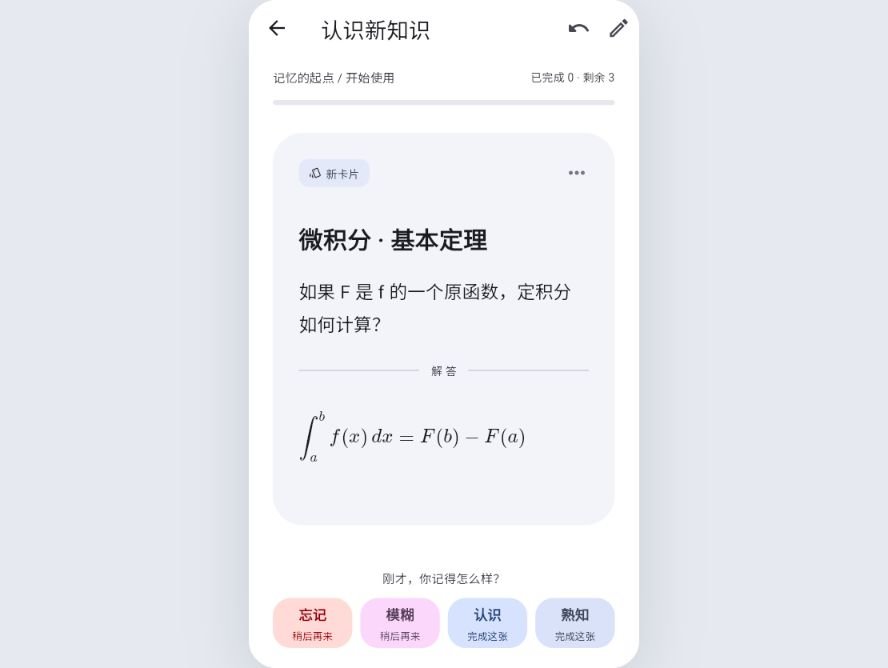
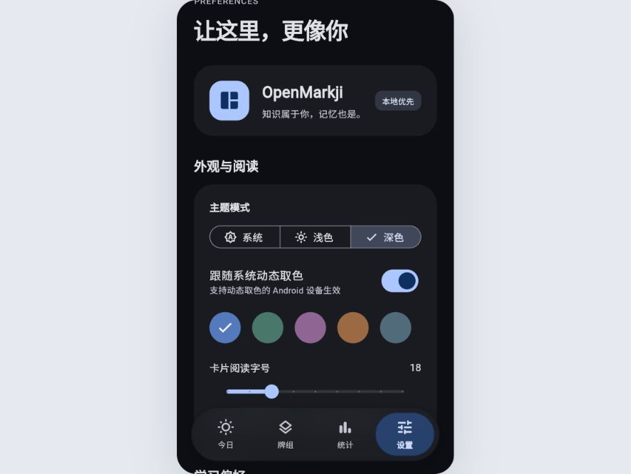

# OpenMarkji

离线优先的开源记忆卡应用。用墨墨语法整理知识，选择卡片加入计划，再按 MMX 排期完成每天的复习与新学。

Flutter 构建，Android 手机优先；玻璃悬浮 Dock、动态取色、浅深色主题，840px 起使用侧栏与牌组双栏。视觉参考 FlClash，UI 在本项目重新实现。

| 今日任务 | 公式与复习 | 深色设置 |
| --- | --- | --- |
|  |  |  |

## 已实现

- 今日、牌组、统计、设置四个入口；页面、弹层、编辑器和复习采用统一主题。
- 牌组分组、章节、标签与搜索；分页列表和批量加入计划、暂停、移动、删除。
- 墨墨源码编辑、自动草稿、光标恢复、预览及本地图片；支持文字样式、段落、挖空、LaTeX 和答案线。
- 粘贴／TXT 导入、UTF-8／UTF-16、分隔设置、逐卡排除与重复跳过；导出语法文本或纯文本。
- 选卡后先复习再新学；每日额度按已经学过的新卡扣除，退出、重启或刷新可以续学。
- 首次正式评分调用原有 MMX；忘记／模糊的卡稍后重学，重学单独记录，不覆盖长期记忆状态。
- 收藏重点卡片；按收藏或最近难卡筛选。难卡依据最近一次正式评分，认识或熟知后移出难卡筛选。
- 专项练习可从全部、收藏或难卡中随机抽取 10／20／50 张，支持独立续练和本轮巩固清单；不改每日队列和长期排期。
- 撤销最近评分，恢复卡片状态、日志和队列；编辑或批量管理之后清除旧撤销快照。
- 学习日历、首次回忆表现、用时、未来七天数量、卡片历史和遗忘曲线。
- Drift＋SQLite 本地数据；旧 JSON 一次性迁移；含媒体、设置及学习进度的 ZIP 备份与恢复。

## 开始使用

Android 安装包：[1.01 发布页](https://github.com/coffe01-10/openmarkji/releases/tag/v1.01)。大多数手机选择 [ARM64 APK](https://github.com/coffe01-10/openmarkji/releases/download/v1.01/OpenMarkji-1.01-android-arm64-v8a.apk)；旧设备及模拟器可在发布页选择对应架构。当前安装包沿用测试签名，详情见发布说明。

1. 新建牌组，导入文本或写卡片。也可在今日页选择三张示例。
2. 在牌组中勾选卡片，点击“加入计划”。仅导入的资料不会自动进入每日任务。
3. 回到今日开始学习，先回忆、再揭晓，并按真实感受评分。
4. 设置中可以备份资料；恢复会替换当前资料，并保留一份恢复前的备份供导出。
5. 牌组右上角的“专项练习”可随时加练；进度自动保存，未完成时可从今日页继续。学习中也可收藏重点或暂停不适合当前计划的卡片。

详细格式和已知边界见 [导入与语法说明](docs/IMPORT.md)。示例文件：[markji-demo.txt](examples/markji-demo.txt)。

设置提供 FlClash 风格的玻璃菜单、全局玻璃透明度与模糊调节、当日重学间隔、学习触感和显示偏好。关于页提供更新检查、协议与数据说明、帮助和反馈报告导出。当前没有在线反馈服务，报告由用户自行分享。

学习偏好可以选择 MMX-5.0／MMX-6.0 作为新牌组默认算法，也可统一应用到已有牌组；切换版本时重置该牌组的自定义参数，保留卡片历史和当前复习日期，在下次正式评分时按历史重算。学习量统计按当前计划内卡片的近 7／30／90 个自然日计算，复习均值不包含首次学习、当日重学或专项练习。

发布时可以通过 `--dart-define=OPENMARKJI_UPDATE_URL=https://你的域名/releases.json` 配置更新源。源文件格式为 `{"version":"1.1.0","notes":"更新说明","downloadUrl":"https://你的域名/download"}`，Web 使用时需要源站允许跨域。未配置时更新页会如实提示，应用仍可正常使用。

## 开发与构建

本次使用 Flutter **3.47.7** / Dart **3.13.5**。依赖版本固定在 `pubspec.lock`。

```sh
flutter pub get
flutter test --no-pub
flutter analyze
flutter run -d web-server --web-port 5127 --no-pub
```

构建 Web 后，也可用 Node 启动本机预览：

```sh
flutter build web --no-pub --no-web-resources-cdn
node tool/preview.mjs
# http://127.0.0.1:5127        宽屏
# http://127.0.0.1:5127/phone  手机容器
```

Web 使用随项目提供的 SQLite Wasm 与 Drift Worker，刷新后资料仍保存在此浏览器的站点存储中。清除站点数据会清除 Web 资料库，建议导出备份。Web 与原生端资料独立。

Android：

```sh
flutter build apk --debug --no-pub
flutter build apk --release --split-per-abi --no-pub
```

Windows 中文路径下，AOT 编译器可能误读路径，使用：

```powershell
./tool/build_android.ps1
```

脚本通过临时 ASCII 目录链接构建，并在结束时移除链接。Gradle 配置关闭了已在此项目复现的跨盘 Kotlin 增量缓存问题。APK 位于 `build/app/outputs/flutter-apk/`；当前沿用 Flutter 模板的**测试签名**，正式发布时需替换为自己的发布密钥。

Windows 未开启开发者模式时，`flutter pub get` 的桌面插件链接步骤可能提示权限问题；Android/Web 使用已经完成下载的依赖仍可构建。本次交付未把桌面系统设置变更作为要求。

## 算法与兼容范围

`lib/algorithms/` 保留项目原有 MMX-5 / MMX-6 实现，85% 目标保留率和评分编码不变。当前默认参数来自项目原有公开参数，不等同于取得墨墨产品内的个人参数；本应用不承诺与墨墨产生完全相同的排期。

评分编码为：认识 1、模糊 2、忘记 3、熟知 4。调度间隔使用两次正式复习的实际时间差；当日重学不会再次训练长期状态。编辑页、导入页与学习页共用同一解析器和渲染器。

首版未包含账号、联网同步、社区、AI 制卡、Anki 包导入、音频或选择题交互。未知语法保留原文；墨墨媒体 ID 没有对应资源时需要手动关联图片。真实墨墨导出样本的跨卡自动识别、图片资源还原尚待样本验证。

## 代码入口

- `lib/data/`：数据库、资料管理、学习会话、备份、平台连接与文件导出。
- `lib/content/`：墨墨语法扫描、导入解码和切卡。
- `lib/domain/`：牌组、卡片、队列及偏好。
- `lib/ui/`：主题、Dock、页面和内容渲染器。
- `lib/algorithms/`：MMX 核心；`bin/` 和旧 `services/scheduler.dart` 保留算法演示用途，应用使用新的 `AppStore`。
- `test/`：算法、导入、事务、会话、备份和界面回归测试。

媒体字节保存在应用管理的 SQLite 媒体表中，通过 ID 引用，不依赖原图片的外部路径；备份能一起带走。该实现使原生和 Web 使用同一资源模型。

原始代码采用 MIT。液态玻璃、背景采样、导航栏与弹簧动画移植自 [FlClash](https://github.com/chen08209/FlClash)，这些组件采用 GPL-3.0；分发包含它们的完整应用时须遵守 GPL-3.0。来源与改动见 [第三方说明](third_party/FlClash/NOTICE.md)，完整许可证见 [FlClash LICENSE](third_party/FlClash/LICENSE)。墨墨语法参考 [maimemo/memo-skills](https://github.com/maimemo/memo-skills)。Web 数据库运行文件来自 [Drift 2.35.2 官方发布](https://github.com/simolus3/drift/releases/tag/drift-2.35.2)。
