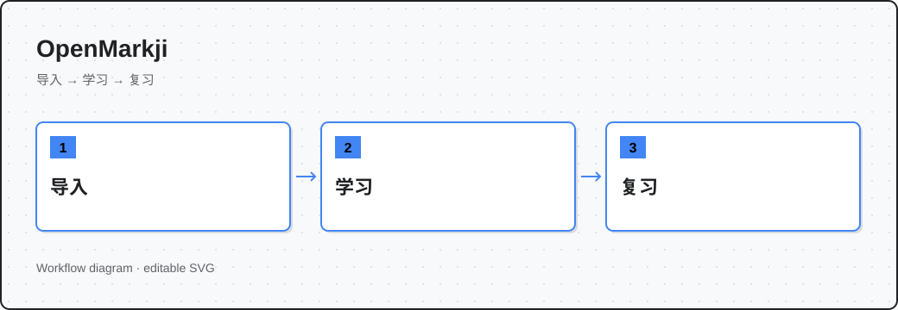
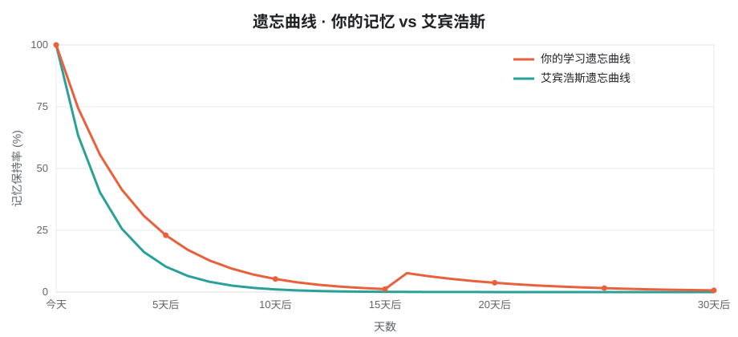
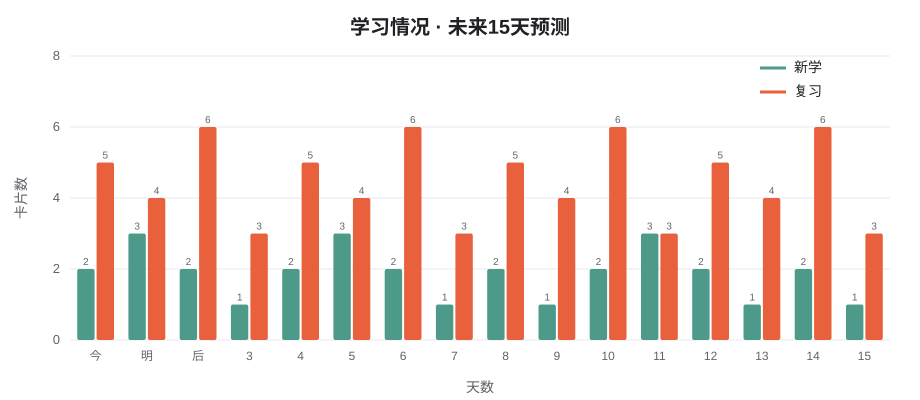
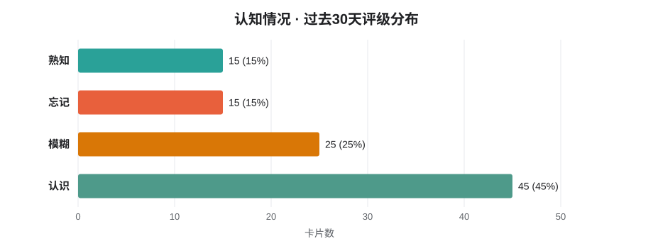

<p align="center">
  
</p>

<p align="center">
  <a href="README.md">简体中文</a> | <a href="README.en.md">English</a>
</p>

<p align="center">
  
  
  
</p>

**离线优先的开源记忆卡应用**。用墨墨语法整理知识，选择卡片加入计划，再按 MMX 排期完成每天的复习与新学。



## 为什么选择 OpenMarkji

记忆需要间隔重复，但手动安排太繁琐。OpenMarkji 把知识整理成卡片，自动计算最佳复习时间。你只需要专注回忆，剩下的交给算法。

## 核心功能

**四种卡片类型**：问答、挖空、LaTeX 公式、答案线。用纯文本写卡片，自动解析墨墨语法：

```text
[P#H1#微积分 · 基本定理]
如果 F 是 f 的一个原函数，定积分如何计算？
---
[E##\int_a^b f(x)\,dx=F(b)-F(a)]
===CARD===
[P#H1#分组挖空]
记忆是在[F#1#恰当的时间]进行[F#2#主动回忆]。
```

**三视图统计**：遗忘曲线、学习情况、记忆持久度。看自己的记忆保持率随时间变化，对比艾宾浩斯曲线。







**专项练习**：从全部、收藏或难卡中随机抽取 10/20/50 张，独立保存进度，不打乱日常计划。

**完整数据**：Drift+SQLite 本地存储，支持 ZIP 备份恢复，媒体文件随备份一起带走。

## 快速开始

### Android 安装

[1.01 发布页](https://github.com/coffe01-10/openmarkji/releases/tag/v1.01)。大多数手机选择 ARM64 APK；旧设备可在发布页选择对应架构。

1. 新建牌组，导入文本或写卡片
2. 在牌组中勾选卡片，点击"加入计划"
3. 回到今日开始学习，先回忆、再揭晓，按真实感受评分
4. 设置中可以备份资料；恢复会替换当前资料，并保留恢复前的备份

### 从源码构建

```sh
flutter pub get
flutter build apk --release --split-per-abi
```

或使用提供的脚本（Windows 中文路径）：

```powershell
./tool/build_android.ps1
```

### Web 预览

```sh
flutter build web --no-pub --no-web-resources-cdn
node tool/preview.mjs
# http://127.0.0.1:5127        宽屏
# http://127.0.0.1:5127/phone  手机容器
```

## 算法说明

`lib/algorithms/` 保留 MMX-5 / MMX-6 实现，85% 目标保留率。评分编码：认识 1、模糊 2、忘记 3、熟知 4。

调度间隔使用两次正式复习的实际时间差；当日重学不会再次训练长期状态。编辑页、导入页与学习页共用同一解析器和渲染器。

## 项目结构

- `lib/data/`：数据库、学习会话、备份、平台连接
- `lib/content/`：墨墨语法解析和切卡
- `lib/domain/`：牌组、卡片、队列及偏好
- `lib/ui/`：主题、Dock、页面和内容渲染器
- `lib/algorithms/`：MMX 核心算法
- `test/`：算法、导入、事务、界面回归测试

## 许可证

[GPL-3.0 协议原文](third_party/GPL-3.0/LICENSE) · [版权及修改说明](third_party/GPL-3.0/NOTICE.md)
